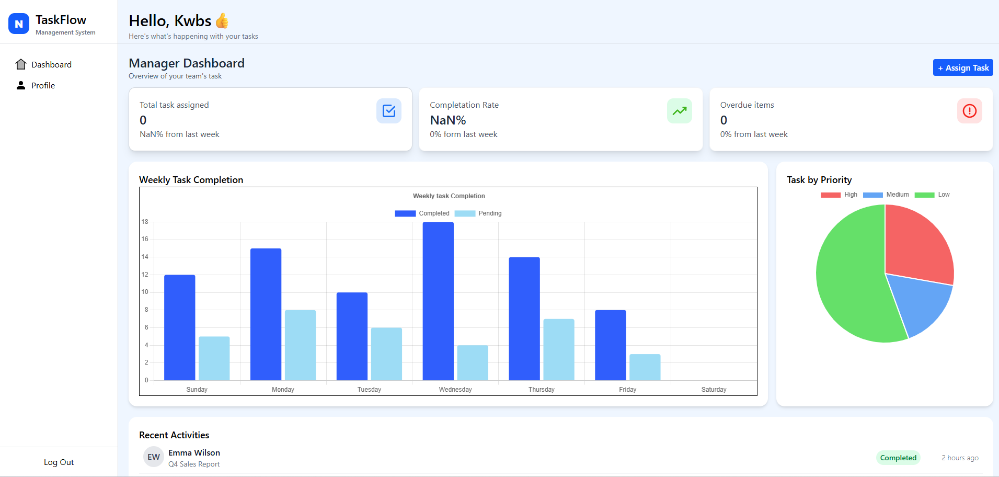
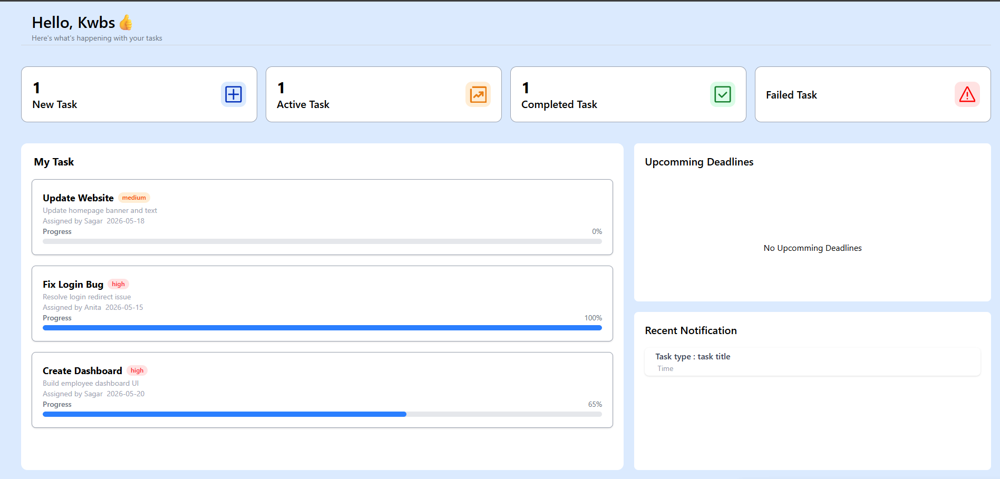

# TaskFlow

TaskFlow is a browser-based task management dashboard with separate views for employees and administrators. Employees can review their assigned work, progress, and upcoming deadlines; administrators can see a team overview with task metrics, charts, and recent activity.

> **Demo application:** TaskFlow uses seeded sample data and client-side authentication. It has no backend, and is not suitable for real accounts, sensitive information, or production use.

## Screenshots

| Admin dashboard | Employee dashboard |
| --- | --- |
|  |  |

## Features

- **Role-based sign-in** with separate admin and employee routes.
- **Employee dashboard** with task counts, task cards, priority labels, progress bars, and upcoming deadlines.
- **Admin dashboard** with task summary cards, weekly completion and priority charts, and a recent activity list.
- **Protected routes** that redirect signed-out users to the login page.
- **Responsive layouts** styled with Tailwind CSS.
- **Sample data** for five employees and three administrators, initialized in the browser.

Some visible controls and sections are presentation-only. For example, task assignment, notifications, and profile pages are not backed by a complete task-management workflow.

## Tech stack

- React 19
- React Router 7
- Vite 8
- Tailwind CSS 4
- Chart.js and `react-chartjs-2`

## Getting started

### Prerequisites

- Node.js 20.19+ or 22.12+
- npm

### Install and run

```bash
npm install
npm run dev
```

Open the local URL printed by Vite in your terminal.

### Demo accounts

Use one of these seeded accounts to explore each role:

| Role | Email | Password |
| --- | --- | --- |
| Admin | `admin@example.com` | `123` |
| Employee | `employee1@example.com` | `123` |

Other seeded accounts are defined in `src/utils/localStorage.jsx`.

## Available scripts

| Command | Description |
| --- | --- |
| `npm run dev` | Start the Vite development server. |
| `npm run build` | Create a production build in `dist/`. |
| `npm run preview` | Preview the production build locally. |
| `npm run lint` | Run ESLint on the project. |

## Application routes

| Path | Access | View |
| --- | --- | --- |
| `/` and `/login` | Public | Sign-in page |
| `/dashboard` | Employee | Employee task dashboard |
| `/admin/dashboard` | Admin | Admin overview dashboard |
| `/admin/profile` | Admin | Profile placeholder |
| `/user/:id` | Signed-in users | User profile placeholder |

## Project structure

```text
src/
├── components/
│   ├── Dashboard/      # Admin and employee dashboard layouts
│   ├── TaskList/       # Employee task cards and task list
│   ├── charts/         # Admin dashboard charts
│   └── others/         # Headers, summaries, deadlines, and UI sections
├── context/            # Authentication context
├── data/               # Sample recent-activity data
├── pages/              # Login, dashboard, profile, and fallback pages
├── routes/             # Route definitions and route protection
└── utils/              # Seed data and browser-storage helpers
public/                 # App icon and dashboard screenshots
```

## Data and authentication

The app seeds administrator and employee records in `localStorage` when it starts. Sign-in checks those records in the browser, and the active user is stored in `sessionStorage`. There is no server-side authentication or database.

The seed data includes plaintext demo passwords. The initialization also writes the seed records on app startup, so changes to stored sample data are not a durable persistence mechanism. Do not use real credentials or sensitive data with this demo.

## Build and deployment

Create and preview a production build with:

```bash
npm run build
npm run preview
```

The generated static site is in `dist/`. When deploying to a static host, configure a fallback to `index.html` for client-side routes such as `/dashboard` and `/admin/dashboard`.
